# VSDBabySoC: Physical Design & Multi-Corner STA (RTL → Routed Layout)

**Student:** K. V. Ganesh Koushal  |  **Roll No:** 24EG104A13
**Design:** VSDBabySoC  |  **PDK / Platform:** SkyWater Sky130HD  |  **Tool:** OpenROAD (v2.0-25794-g7cbd77e248)

This folder documents the **backend (physical design) flow** of VSDBabySoC, taking the synthesized gate-level netlist through floorplan, placement, clock tree synthesis, routing, and **multi-corner static timing analysis across 16 PVT corners**. The front-end work (RTL simulation and logic synthesis) is documented in the companion folder `BabySoC_RTL&Logic_Synthesis`.

---

## 📑 Table of Contents
1. [Flow Overview](#1-flow-overview)
2. [Floorplan](#2-floorplan)
3. [Placement](#3-placement)
4. [Clock Tree Synthesis (CTS)](#4-clock-tree-synthesis-cts)
5. [Routing](#5-routing)
6. [Post-Route OpenROAD GUI Evidence](#6-post-route-openroad-gui-evidence)
7. [Multi-Corner Static Timing Analysis](#7-multi-corner-static-timing-analysis)
8. [Key Observations](#8-key-observations)
9. [Limitations & Sign-off Notes](#9-limitations--sign-off-notes)
10. [Folder Contents](#10-folder-contents)

---

## 1. Flow Overview

| Stage | Description | Evidence |
|---|---|---|
| Synthesis (input) | Gate-level netlist `results/sky130hd/vsdbabysoc/base/1_synth.v` | See RTL & synthesis folder |
| Floorplan | Die/core definition, macro (DAC, PLL) placement, tap cells | `Floorplan.png`, `pll_floorplan.png` |
| Placement | Global + detailed placement of standard cells | `Place.png`, `Placement.png`, `Place_Report.png` |
| Congestion / density | Heatmap analysis of the placed design | `Heatmap.png`, `Heatmap2.png` |
| CTS | Clock tree built, clock nets inspected | `CTS.png`, `Clk_nets.png`, `cts_rpt.png` |
| Routing | Global + detailed routing (post-route views) | `POST_ROUTE.png`, `POST_ROUTE2.png` |
| STA | 16-corner setup & hold analysis | `STA_VSDBabySoC.png`, plots and tables in Section 7 |

---

## 2. Floorplan

Die and core area were defined, macros were placed, and tap cells were inserted in rows across the core.

**Floorplan view**

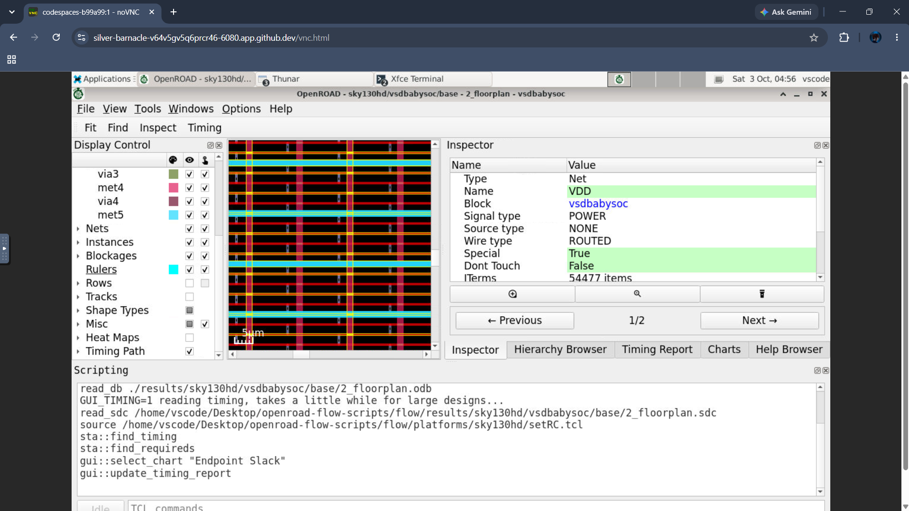

**Floorplan with PLL macro**

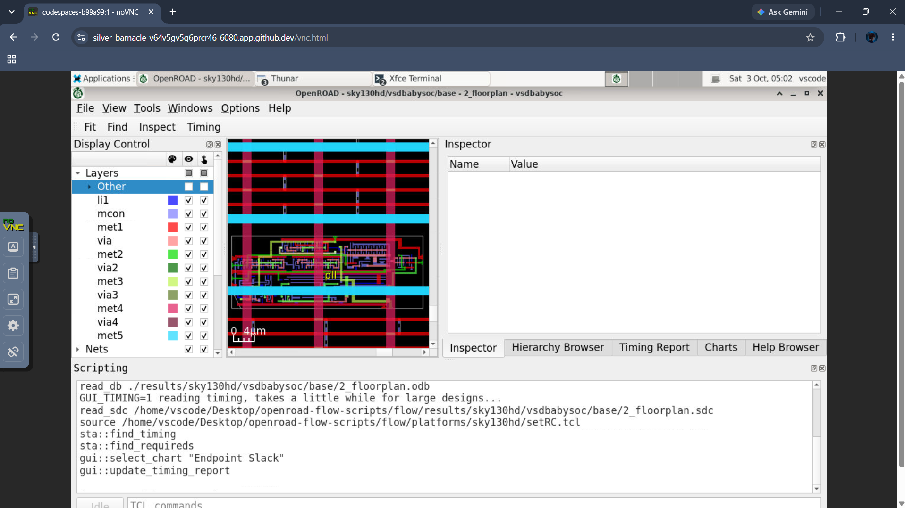

---

## 3. Placement

Standard cells were placed around the macros. The placement report and the resulting layout views are shown below.

**Placement view**

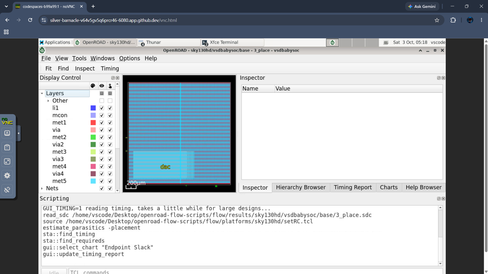

**Placement result**

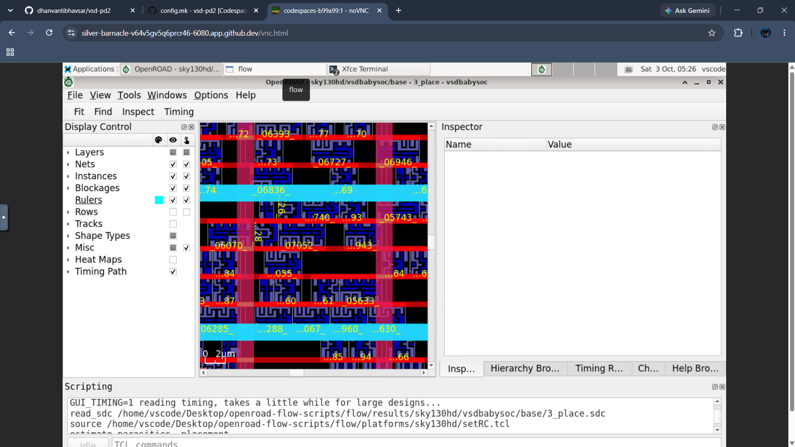

**Placement report**

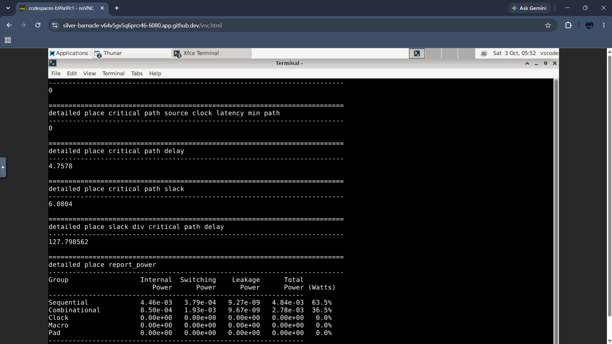

### Heatmap analysis

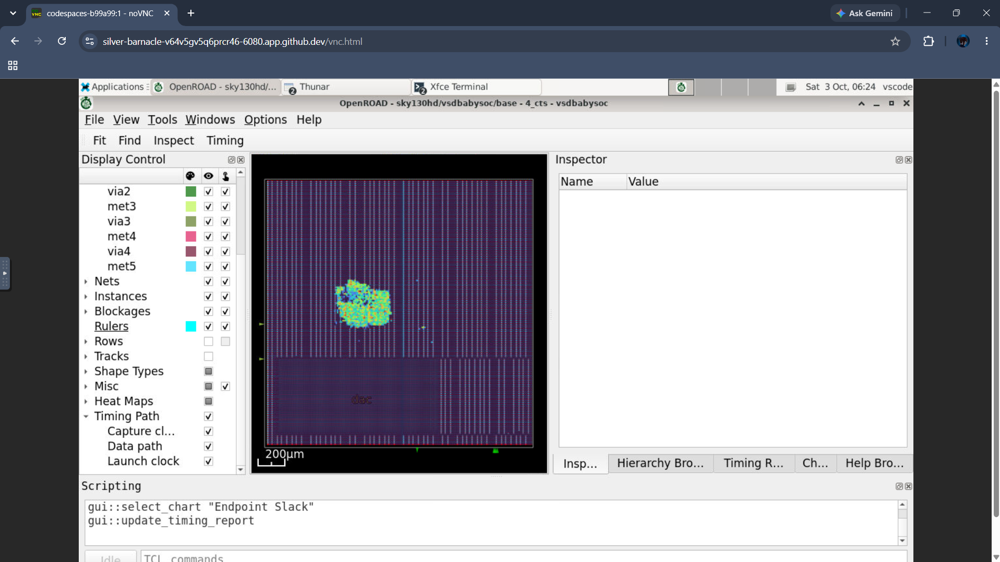

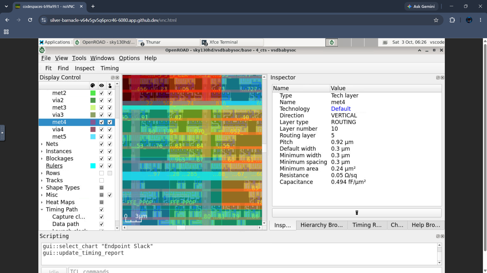

---

## 4. Clock Tree Synthesis (CTS)

CTS was run to distribute the `clk` signal (12 ns period, 83.33 MHz) to all sequential elements.

**CTS result**

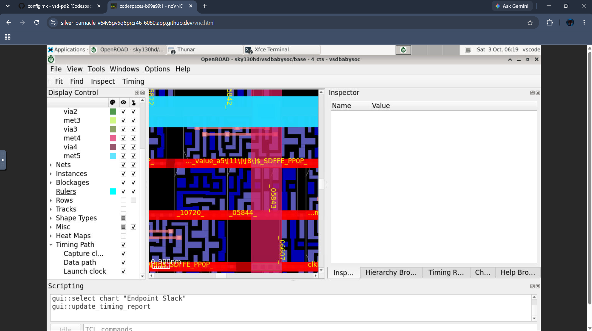

**Clock nets**

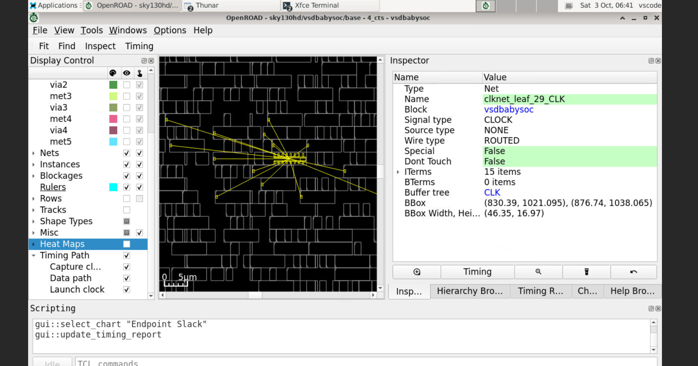

**CTS report**

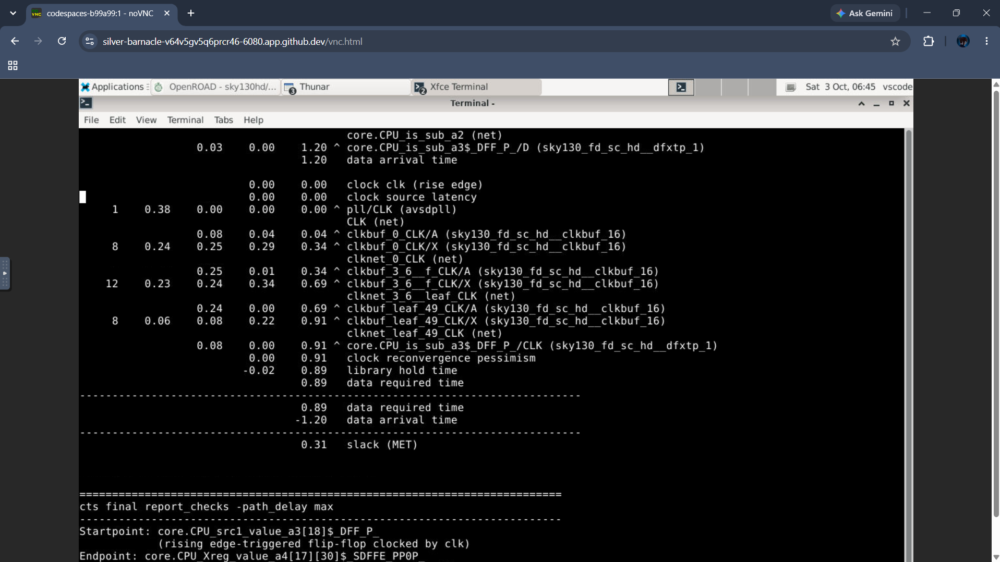

---

## 5. Routing

Global and detailed routing were completed on the Sky130HD metal stack (li1, met1 – met5 with vias).

**Post-route layout**

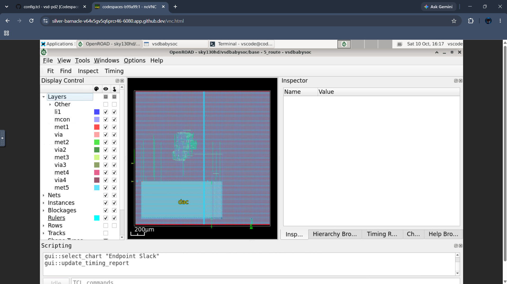

**Post-route layout (zoomed)**

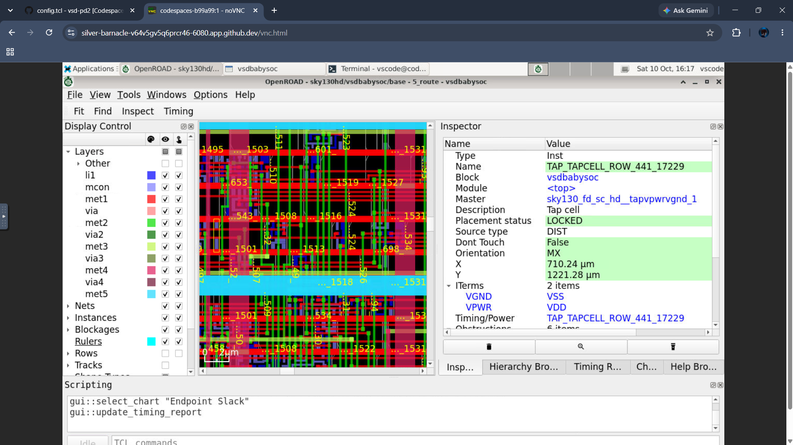

---

## 6. Post-Route OpenROAD GUI Evidence

Screenshots from the OpenROAD GUI (`OpenROAD - sky130hd/vsdbabysoc/base - 5_route - vsdbabysoc`):

- **Overall routed layout:** the full VSDBabySoC layout with the **DAC macro** visible, and routing layers (li1, mcon, met1 – met5) enabled in the Display Control panel.
- **Zoomed view:** a region showing individual routing layers and a selected **tap-cell instance** (`TAP_TAPCELL_ROW_441_17229`, master `sky130_fd_sc_hd__tapvpwrvgnd_1`, status LOCKED, at X = 710.24 µm, Y = 1221.28 µm).

| Overall routed layout | Zoomed routing view |
|---|---|
|  |  |

---

## 7. Multi-Corner Static Timing Analysis

Static Timing Analysis checks whether data paths meet timing under different **process, voltage, and temperature (PVT)** conditions. STA was run across **16 PVT library corners** of Sky130HD.

### 7.1 Setup

| Parameter | Value |
|---|---|
| Tool | OpenROAD v2.0-25794-g7cbd77e248 |
| Platform | Sky130HD |
| Clock | `clk`, 12.00 ns period (83.33 MHz) |
| Corners | 16 PVT library corners |
| Netlist used by STA script | `results/sky130hd/vsdbabysoc/base/1_synth.v` |
| Method | `report_checks` run separately per corner: max-delay paths (setup), min-delay paths (hold), up to 100 path groups per report |

### 7.2 Corner-by-Corner WNS / TNS (earlier compiled results)

These values come from the earlier corner-by-corner results table.

| # | Process | Temp. | Voltage (V) | WNS (ns) | TNS (ns) |
|---|---|---|---|---|---|
| 1 | FF | 100°C | 1.65 | 0.00 | 0.00 |
| 2 | FF | 100°C | 1.95 | 0.00 | 0.00 |
| 3 | FF | −40°C | 1.56 | 0.00 | 0.00 |
| 4 | FF | −40°C | 1.65 | 0.00 | 0.00 |
| 5 | FF | −40°C | 1.76 | 0.00 | 0.00 |
| 6 | FF | −40°C | 1.95 | 0.00 | 0.00 |
| 7 | SS | 100°C | 1.40 | -17.12 | -2599.51 |
| 8 | SS | 100°C | 1.60 | -7.87 | -892.70 |
| 9 | SS | −40°C | 1.28 | -62.56 | -13957.59 |
| 10 | SS | −40°C | 1.35 | -39.70 | -7993.79 |
| 11 | SS | −40°C | 1.40 | -29.69 | -5466.48 |
| 12 | SS | −40°C | 1.44 | -23.91 | -4107.19 |
| 13 | SS | −40°C | 1.60 | -10.61 | -1355.80 |
| 14 | SS | −40°C | 1.76 | -4.38 | -367.93 |
| 15 | TT | 25°C | 1.80 | 0.00 | 0.00 |
| 16 | TT | 100°C | 1.80 | 0.00 | 0.00 |

### 7.3 WNS and TNS Line Plots

The plots compare corner-specific values across the 16 library corners (x-axis = corner index from the table above).

**WNS by library corner**

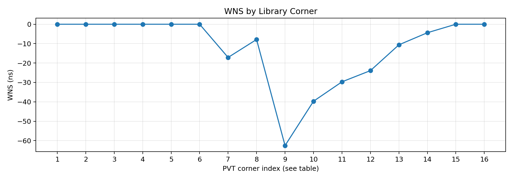

**TNS by library corner**

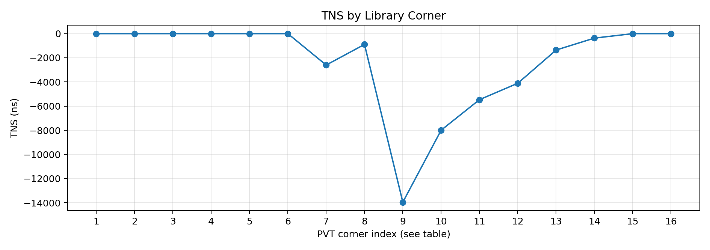

### 7.4 Updated Multi-Corner Setup and Hold Results

The charts and table below were generated from the **16 per-corner setup and hold reports** produced by OpenROAD. For each report, the plotted value is the **minimum slack among the paths captured in that report**. These are worst *reported* path values, not independently verified design-wide WNS or TNS.

**Setup slack by PVT corner**

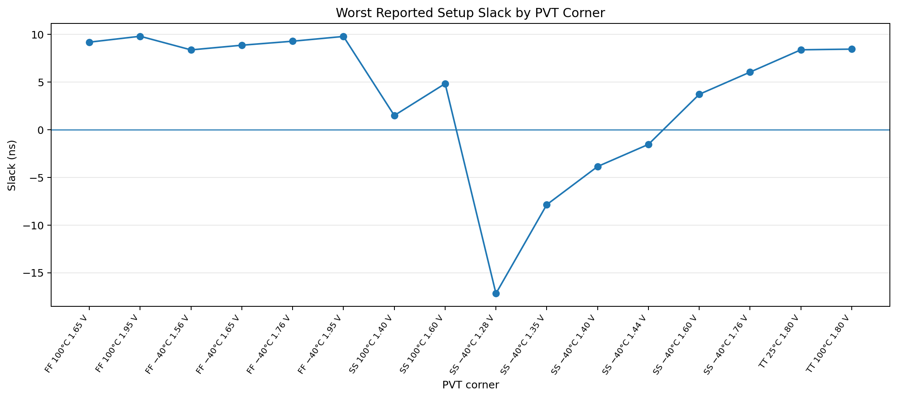

Four corners show negative worst reported setup slack, all at SS −40°C: **1.28 V (−17.17 ns)**, **1.35 V (−7.85 ns)**, **1.40 V (−3.85 ns)** and **1.44 V (−1.53 ns)**.

**Hold slack by PVT corner**

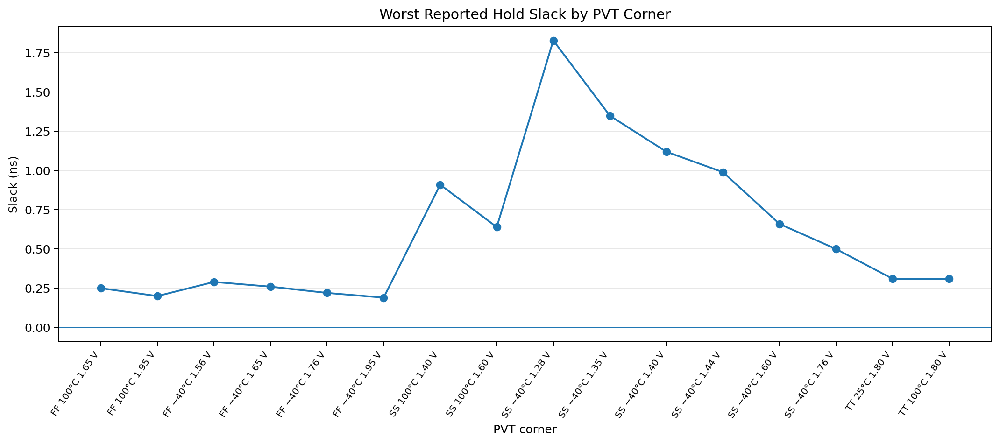

All 16 reports show **positive** worst reported hold slack, ranging from **+0.19 ns to +1.83 ns**.

### 7.5 Per-Corner Setup and Hold Summary

| PVT Corner | Setup Slack (ns) | Hold Slack (ns) |
|---|---|---|
| FF 100°C 1.65 V | +9.19 | +0.25 |
| FF 100°C 1.95 V | +9.81 | +0.20 |
| FF −40°C 1.56 V | +8.38 | +0.29 |
| FF −40°C 1.65 V | +8.87 | +0.26 |
| FF −40°C 1.76 V | +9.29 | +0.22 |
| FF −40°C 1.95 V | +9.79 | +0.19 |
| SS 100°C 1.40 V | +1.50 | +0.91 |
| SS 100°C 1.60 V | +4.84 | +0.64 |
| SS −40°C 1.28 V | **-17.17** | +1.83 |
| SS −40°C 1.35 V | **-7.85** | +1.35 |
| SS −40°C 1.40 V | **-3.85** | +1.12 |
| SS −40°C 1.44 V | **-1.53** | +0.99 |
| SS −40°C 1.60 V | +3.72 | +0.66 |
| SS −40°C 1.76 V | +6.05 | +0.50 |
| TT 25°C 1.80 V | +8.39 | +0.31 |
| TT 100°C 1.80 V | +8.46 | +0.31 |

### 7.6 Final OpenROAD STA Execution Proof

The terminal screenshot below shows the final multi-corner STA run: **worst slack max −17.17 ns**, **TNS max −5241.23**, and the message **"STA COMPLETED FOR ALL 16 PVT CORNERS"**.

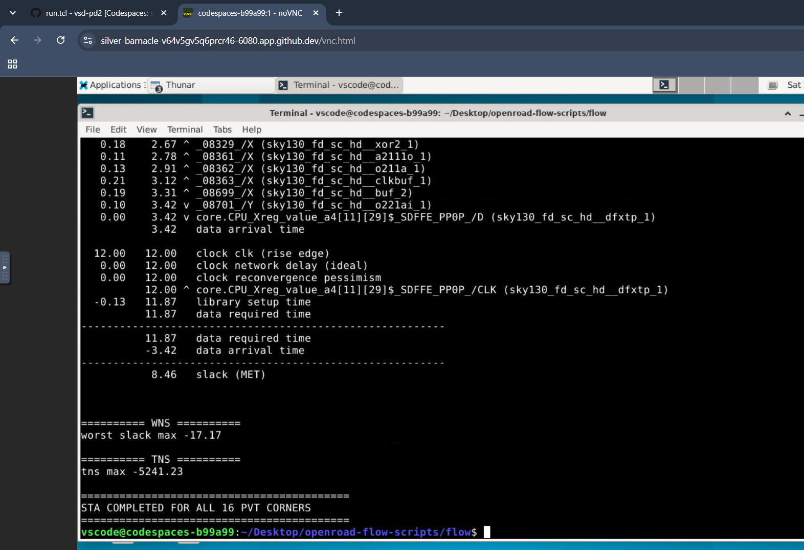

Additional STA screenshot:

> **Evidence note:** since more than 18 individual setup and hold screenshots/reports cannot all be uploaded, the final-result screenshot above is submitted as consolidated proof of execution. The per-corner setup and hold report files were generated separately in the `timing_reports` directory.

---

## 8. Key Observations

- **Hold timing is healthy:** all 16 corners report positive worst hold slack (+0.19 ns to +1.83 ns).
- **Setup is the limiting check:** negative setup slack appears only in the **slow-process (SS), −40°C, low-voltage** corners (1.28 – 1.44 V), with the worst at **SS −40°C 1.28 V (−17.17 ns)**.
- **FF and TT corners meet setup** with large margins (+8.38 ns to +9.81 ns).
- Setup slack improves steadily as supply voltage rises within the SS −40°C group (−17.17 → +6.05 ns from 1.28 V to 1.76 V), as expected for slower cells at low voltage.
- At the 12 ns clock target, setup timing at the lowest-voltage SS corners would need a relaxed clock period, further optimization, or restricting sign-off to the supported operating voltage range.

---

## 9. Limitations & Sign-off Notes

- The **corner-by-corner WNS/TNS table (7.2)** comes from the earlier compiled results. The later `run.tcl` execution called `report_worst_slack` and `report_tns` without selecting a corner, so the global values it printed repeated and are not per-corner. This is why the earlier table (e.g. WNS −62.56 ns at SS −40°C 1.28 V) and the later per-corner reports (−17.17 ns at the same corner) differ. The per-corner `report_checks` results in 7.4 – 7.5 are the more reliable reference.
- The updated slack values are **worst reported path values** from reports capped at 100 path groups. They are **not** independently verified design-wide WNS/TNS, and no TNS is claimed from them.
- Hold results describe the captured paths only and **should not be treated as complete hold-closure sign-off**.
- Formal sign-off would additionally require confirming corner-specific constraints, extracted parasitics (SPEF), propagated-clock analysis, and complete hold checks.

---

## 10. Folder Contents

| File | Description |
|---|---|
| `Floorplan.png`, `pll_floorplan.png` | Floorplan views |
| `Place.png`, `Placement.png`, `Place_Report.png` | Placement views and report |
| `Heatmap.png`, `Heatmap2.png` | Heatmap views |
| `CTS.png`, `Clk_nets.png`, `cts_rpt.png` | Clock tree synthesis results and report |
| `POST_ROUTE.png`, `POST_ROUTE2.png` | Post-route layout views |
| `STA_VSDBabySoC.png`, `STA_EXEC_ALL16FILES.png` | STA screenshots / execution proof |
| `WNS_PLOT.png`, `TNS_PLOT.png` | WNS and TNS plots across 16 corners |
| `WORST_REPORTED_SETUP_SLACK.png`, `WORST_REPORTED_HOLD_SLACK.png` | Setup and hold slack plots |

---

*Prepared by K. V. Ganesh Koushal (24EG104A13), VSD Workshop: VSDBabySoC physical design and multi-corner STA.*
